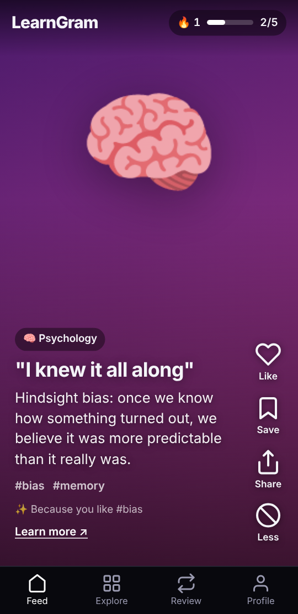
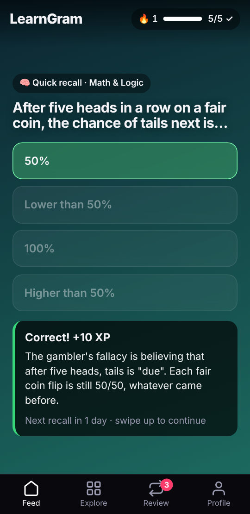
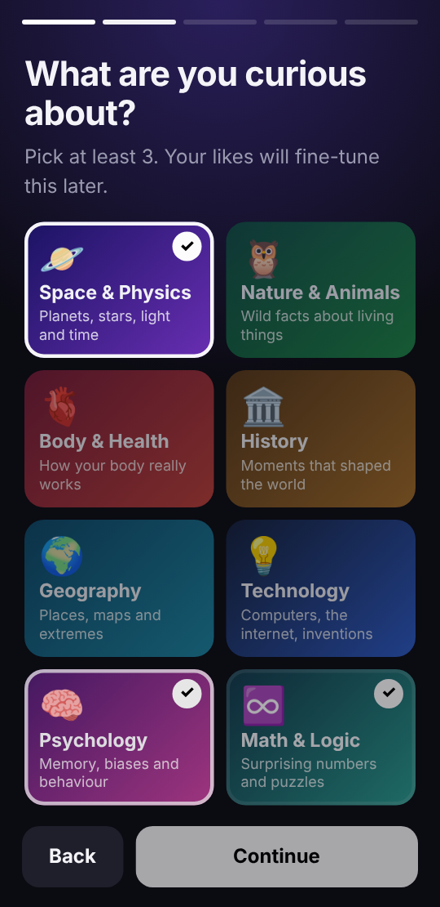
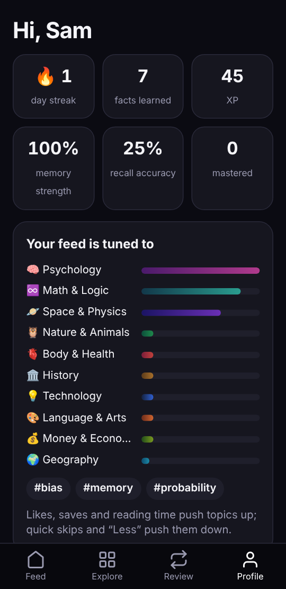

# LearnGram

A swipeable, full-screen feed of short facts — like Reels or TikTok, but built so you actually remember what you scroll past.

<p>
  
  
  
  
</p>

**Web app:** https://jaro0121.github.io/LearnGram/ · **Android:** APK on the [Releases](../../releases) page

## Features

- **Vertical swipe feed** with like (button or double-tap), save, share and "show less"
- **Personal questionnaire** on first launch: interests, daily goal, how much you want to remember, how adventurous the feed should be
- **10 categories, 200 hand-written facts** bundled for offline use, each with a recall question
- **Like-driven recommendations**: cards similar to what you liked move to the front, and each card says why it was picked
- **Spaced-repetition recall cards** slipped into the feed right before you would forget, plus a Review tab
- **Live content** (optional): related Wikipedia articles and Open Trivia DB questions
- **Streaks, XP, daily goal**, memory-strength and recall-accuracy stats
- **Backup & restore** to move progress between devices
- **Works offline**, installs to the home screen (PWA), and ships as a native **Android app**
- **Private by design**: no account, no ads, no analytics — see the [privacy policy](public/privacy.html)

## Install on your phone

| Phone | How |
| --- | --- |
| **iPhone** | Open the web app in **Safari** → Share → **Add to Home Screen** |
| **Android (web)** | Open the web app in **Chrome** → ⋮ → **Install app** |
| **Android (APK)** | Download `LearnGram-x.y.z.apk` from **Releases** → open it → allow "install unknown apps" for your browser |

## Development

```bash
npm install
npm run dev        # open the printed Network URL on your phone (same Wi-Fi)
npm test           # unit tests (scheduler, recommender, feed, parsers)
npm run build && npm run e2e          # end-to-end test in a phone-sized browser (Playwright)
LIVE=1 npm run e2e                    # same, against the real Wikipedia / Open Trivia DB
STORE_SHOTS=1 npm run e2e             # regenerate public/screenshots
node e2e/icons.mjs                    # regenerate icons / splash / social image from public/icon.svg
```

Android (needs Android Studio or the Android SDK + Java 21):

```bash
npm run build && npx cap sync android
cd android && ./gradlew assembleDebug   # → android/app/build/outputs/apk/debug/app-debug.apk
```

CI does all of this for you — see [RELEASING.md](RELEASING.md).

## How the learning works

The design follows the techniques with the strongest evidence in learning research:

| Principle | What the research says | What LearnGram does |
| --- | --- | --- |
| **Retrieval practice** | Recalling a fact strengthens memory more than re-reading it; classroom quizzing improves learning by about half a standard deviation. | Every bundled fact has a question. Seen facts come back as "Quick recall" cards, not as repeats. |
| **Spacing** | Spread-out practice beats massed practice by roughly half a standard deviation on later tests. | Recalls are scheduled at growing gaps: ~10 min → 1 day → days → weeks → months. |
| **Review just before forgetting** | Modern schedulers (FSRS) model memory as a power-law forgetting curve and review when predicted recall drops to a target, needing fewer reviews than fixed-interval schemes like SM-2. | `src/lib/srs.ts` tracks stability and difficulty per fact and schedules the next recall when predicted recall reaches ~90%. Harder-won recalls extend the interval more. |
| **Interleaving** | Mixing topics helps in many (not all) settings. | The feed avoids long runs of one category. |
| **Small daily doses** | Follows from spacing. | A daily goal of 5–20 cards and a streak. |

The scheduler is *inspired by* FSRS (same forgetting-curve shape and the stability/difficulty idea) but is a small,
simplified implementation — it is not the full trained FSRS model.

## How recommendations work

`src/lib/recommender.ts` is a content-based recommender. Each card has a category and tags; your profile holds an affinity score for each.

| Signal | Effect |
| --- | --- |
| Like / double-tap | strong boost for the card's tags and category |
| Save | stronger boost |
| Reading for 7 s+ | small boost |
| Swiping away in under 1 s | small penalty |
| "Less" | strong penalty, card hidden |

Candidates are ranked by *questionnaire interest + category affinity + tag affinity − repetition penalty + exploration noise*.
A like immediately re-ranks every card not yet on screen. Tags are shared across categories, so liking memory facts in
Psychology also surfaces the sleep-and-memory fact in Body & Health. Likes also seed Wikipedia "more like this" searches.

## Content sources & licences

- **Bundled deck** — `src/data/facts.ts`, written for this app; each fact links to its Wikipedia article for further reading.
- **Wikipedia** — MediaWiki Action API (`morelike:` search). Text under CC BY-SA 4.0.
- **Open Trivia DB** — opentdb.com, CC BY-SA 4.0.

## Project layout

```
src/data/                categories and the fact deck
src/lib/srs.ts           spaced-repetition scheduler
src/lib/recommender.ts   like-based ranking
src/lib/feed.ts          mixes new cards, due recalls and live content
src/lib/live.ts          Wikipedia + Open Trivia DB clients (with rate-limit back-off)
src/lib/store.ts         state in localStorage, backup/restore
src/lib/native.ts        Android bridge (share sheet, browser, haptics, back button)
src/components/          onboarding, feed, cards, explore, review, profile
public/                  PWA manifest, service worker, icons, privacy policy
android/                 Capacitor Android project
e2e/                     end-to-end test, icon generator
```

## Research references

- Dunlosky et al. (2013), *Improving Students' Learning With Effective Learning Techniques*; overview: <https://firth.substack.com/p/jonathan-firth-s-memory-metacognition-updates-15-dunlosky-et-al-s-list-of-strategies-1347143>
- Weinstein, Madan & Sumeracki (2018), *Teaching the science of learning*: <https://cognitiveresearchjournal.springeropen.com/articles/10.1186/s41235-017-0087-y>
- University of Minnesota, *Spaced and interleaved practice improves recall*: <https://cei.umn.edu/teaching-resources/leveraging-learning-sciences/spaced-and-interleaved-practice-improves-recall>
- Anki manual, *What spaced repetition algorithm does Anki use?*: <https://faqs.ankiweb.net/what-spaced-repetition-algorithm>
- RemNote, *The FSRS spaced repetition algorithm*: <https://help.remnote.com/en/articles/9124137-the-fsrs-spaced-repetition-algorithm>
